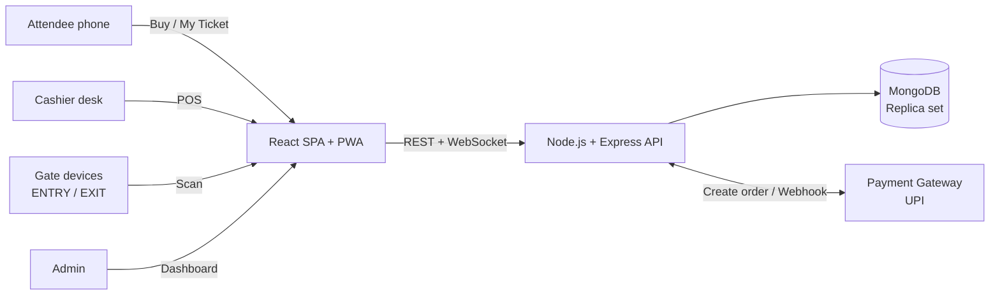
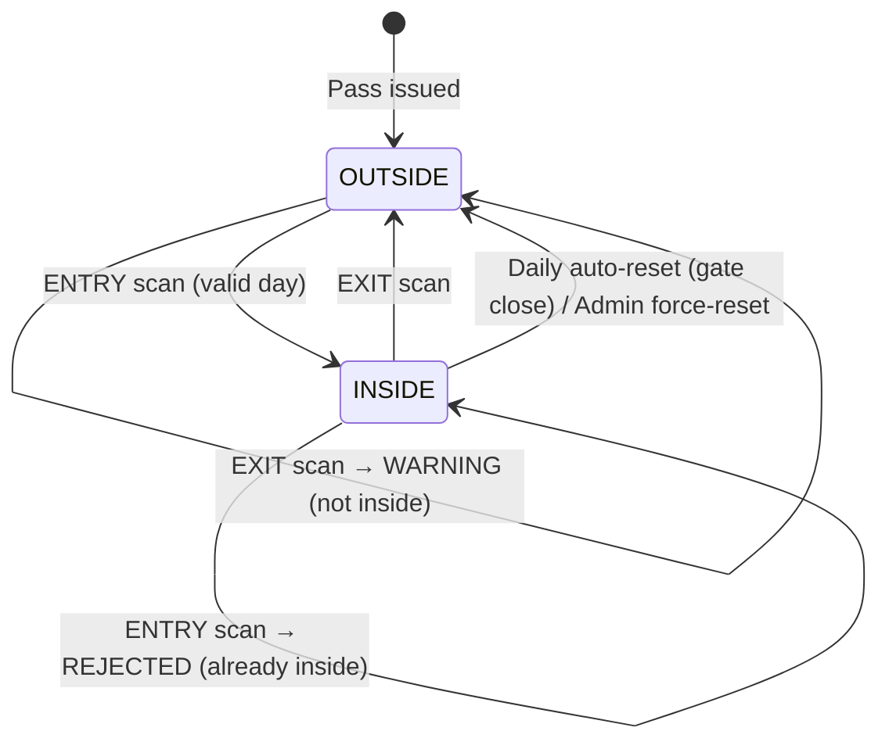
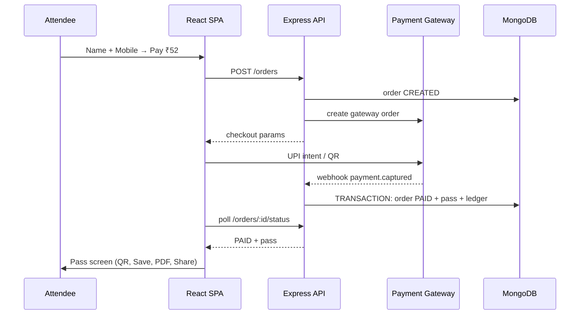
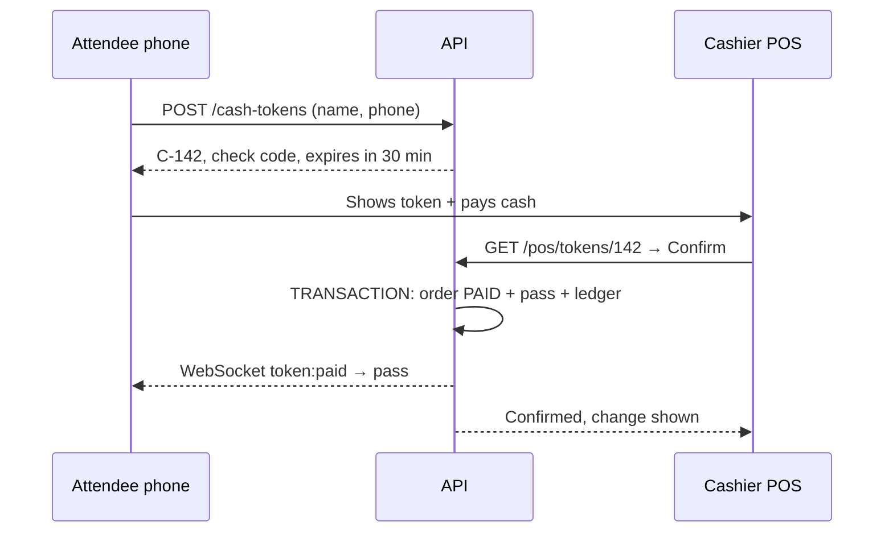

# 3-Day Comics Carnival — Ticketing & Gate Control System

## Software Requirements Specification (SRS)

| Field | Value |
|---|---|
| Document | Software Requirements Specification |
| Version | 2.0 (supersedes PRD v1.0) |
| Date | 24 October 2026 |
| Prepared by | Sourav Dey Halder, Software Engineer |
| Reviewer | Akbar (Senior) |
| Status | Draft for review |
| Stack | MongoDB · Express.js · React (Vite) · Node.js |
| Classification | Confidential |

---

## 0. How to read this document

| If you are… | Read these sections first |
|---|---|
| Reviewer / senior (10-minute pass) | §1.4 What changed, §3 Business Rules, §11 Open Decisions |
| Frontend developer | §5 UI/UX Specification, §4 Functional Requirements |
| Backend developer | §3 Business Rules, §6 Data Model, §7 API, §8 Core Flows |
| QA | §4 (each FR has an ID), §10 Edge Cases, §12 Acceptance Tests |
| Event operations | §2.2 Actors, §13 Event-Day Runbook |

Every requirement has an ID (`FR-`, `NFR-`, `BR-`, `UX-`) so it can be referenced in tickets, commits and test cases.

**Priority key:** **P0** = must ship before event · **P1** = should ship · **P2** = nice to have.

---

## 1. Introduction

### 1.1 Purpose

This document defines everything needed to build, test and run the ticketing and gate-entry system for the **3-Day Comics Carnival**, a physical pop-culture event in West Bengal, India. It turns the original PRD into buildable requirements and records the design decisions taken after the PRD.

### 1.2 Product goals

| # | Goal | Measured by |
|---|---|---|
| G1 | Buying a ticket on a phone takes about 30 seconds | Median time from landing page to pass shown ≤ 45 s |
| G2 | No queue at the gate | Scan-to-result ≤ 500 ms (p95) |
| G3 | Cash buyers at the venue are served fast | ≤ 10 s per person at the cash desk (Method A ≤ 3 s) |
| G4 | No ticket fraud via shared screenshots | Zero double entries while a pass is already inside |
| G5 | Money is split correctly | Organizer share and platform fee match ticket count exactly, every time |
| G6 | Zero recurring delivery cost | No email / SMS / WhatsApp dependency |

### 1.3 Scope

**In scope (v1):** online ticket purchase via UPI, on-screen digital pass with PDF/image download, "My Ticket" recovery page, offline-capable pass (PWA), venue cash token flow, box-office POS, gate scanner with entry/exit anti-passback, admin dashboard with revenue split and footfall analytics, CSV export.

**Out of scope (v1):** email, SMS and WhatsApp delivery; seat selection; multiple ticket categories (VIP etc.); refunds through the app (handled manually); fully offline gate scanning; native mobile apps.

### 1.4 What changed from PRD v1.0

| Area | PRD v1.0 | SRS v2.0 (this document) | Why |
|---|---|---|---|
| Entry rule | One entry per day; second scan rejected | **Unlimited re-entry** with **IN/OUT anti-passback** — a pass that is already inside cannot be used again until it is scanned out | Attendees step out for food, smoke, phone charging; screenshot sharing still blocked |
| Ticket delivery | Nodemailer over SMTP with PDF attachment | **Website-only pass**: on-screen pass, Download PDF, Save Image, Share, "My Ticket" lookup, PWA offline cache | Zero cost, no spam-folder risk, no SMTP setup |
| Gate devices | One scanner mode | Each scanner runs in **ENTRY** or **EXIT** mode | Required for IN/OUT tracking |
| Live in-venue counter | "Estimated" | **Exact** (INSIDE count) | Falls out of IN/OUT design |
| Cash token price | ₹50 shown to attendee | **Open decision D-02** (₹50 vs ₹52) | PRD conflicted with ₹52 pricing |

### 1.5 Definitions

| Term | Meaning |
|---|---|
| Pass | One admission ticket for one person, valid for one or more event days |
| Event Day | A calendar date (IST) on which the carnival is open: Day 1, Day 2, Day 3 |
| Valid Days | The set of event days a pass can be used on, fixed at purchase |
| Presence state | `OUTSIDE` or `INSIDE` — where the system believes the pass holder is |
| Anti-passback | Rule that blocks a second entry while the pass is still `INSIDE` |
| First entry | The first successful ENTRY scan of a pass on a given event day; used for footfall |
| Cash Token | A short code (e.g. `C-142`) generated on the attendee's phone, paid for at the cash desk |
| QR token | HMAC-signed string encoded in the pass QR; contains no personal data |
| Gate Device | A phone/tablet logged in as Gate Volunteer, running the scanner in ENTRY or EXIT mode |
| Organizer Share | ₹50 per pass, owed to the event organizer |
| Platform Fee | ₹2 per pass, retained by the ticketing platform |

### 1.6 References

1. *3-Day Comics Carnival — Official System Specification & PRD v1.0*
2. Design discussions, 23–24 Oct 2026 (re-entry model, pass delivery model)

---

## 2. Overall Description

### 2.1 System context



### 2.2 Actors and permissions

| Role | Who | Can do | Cannot do |
|---|---|---|---|
| **Attendee** (public, no login) | Anyone | Buy pass, view/download own pass, look up pass, create cash token | See any other pass |
| **Gate Volunteer** | Event staff/volunteers | Log in on a gate device, choose gate + mode, scan passes | Sell tickets, see revenue |
| **Cashier** | Box-office staff | Confirm cash tokens, issue POS tickets, see own shift total | Change settings, see platform revenue |
| **Super Admin** | Organizer / platform owner | Everything: dashboard, settings, force-reset, user management, exports | — |

Staff accounts are created only by Super Admin. Login is username + PIN (6 digits) on staff devices, with session tied to the device.

### 2.3 Operating environment

| Item | Requirement |
|---|---|
| Attendee devices | Android 9+ (Chrome 100+), iOS 15+ (Safari), screen width 320 px and up |
| Gate devices | Android phone with rear camera, Chrome, screen ≥ 6", volume at max, charger/power bank |
| Cashier devices | Laptop with Chrome, physical keyboard; optional 58 mm thermal printer |
| Hosting | Node.js 20 LTS server (VPS or cloud VM), MongoDB Atlas replica set (transactions require a replica set) |
| Network at venue | Dedicated Wi-Fi for staff devices + one 4G/5G backup hotspot per gate |
| Time zone | All business logic uses **Asia/Kolkata (IST)** |

### 2.4 Constraints

- MERN stack is fixed.
- Single merchant account for all payments (no split-settlement marketplace gateway).
- No paid messaging services (email/SMS/WhatsApp) in v1.
- Gate scanning needs network connectivity to the API (see NFR-AV-03 for fallback).

### 2.5 Assumptions

- Event dates are fixed and entered by Super Admin before sales open.
- Attendees pay through UPI apps on the same phone they browse on (UPI intent) or by scanning a UPI QR on desktop.
- One pass = one person; there are no group passes.

---

## 3. Business Rules

### 3.1 Pricing & Dynamic Admin Configuration

| ID | Rule |
|---|---|
| BR-P-01 | **Dynamic Admin Pricing:** Ticket base price and platform fee are **NEVER hardcoded**. Both values are configured and controlled dynamically by the Super Admin in `AdminSettings`. Total customer price = `basePricePaise + platformFeePaise`. (Default initialized to ₹50 base + ₹2 platform fee = ₹52 total). |
| BR-P-02 | **Order Snapshotting:** Price and fee are dynamically read from `AdminSettings` at the moment of order creation and **snapshotted onto each order document**. If the Admin later updates the base price or platform fee, past orders, tickets, and ledger entries remain completely immutable. |
| BR-P-03 | Cash pricing follows decision **D-02** (see §11). Until decided, the system supports both via the setting `cashPriceMode = INCLUSIVE_TOTAL | ORGANIZER_ABSORBS_FEE`. |
| BR-P-04 | All amounts are stored as **integer paise** (e.g. ₹50 = 5000, ₹2 = 200, ₹52 = 5200) to eliminate floating-point precision errors. |
| BR-P-05 | **PIN Verification for Price Changes:** Any modification to `basePricePaise` or `platformFeePaise` in the Admin Dashboard requires re-entering the Super Admin 6-digit PIN before saving. |

### 3.2 Dynamic day validity

The pass price never changes; only the number of valid days does.

| Purchase moment (IST) | Valid Days | Badge on pass | Price |
|---|---|---|---|
| Before Day 1, or on Day 1 | Day 1, Day 2, Day 3 | **3-DAY ALL ACCESS** | ₹52 |
| On Day 2 | Day 2, Day 3 | **2-DAY PASS** | ₹52 |
| On Day 3 (before sales cut-off) | Day 3 | **1-DAY FINAL PASS** | ₹52 |
| After Day 3 sales cut-off | Sales closed | — | — |

| ID | Rule |
|---|---|
| BR-V-01 | `validDays` is computed **on the server** from the server clock at the moment the payment is confirmed (not when the order was created), and stored on the pass. |
| BR-V-02 | If an order is created on Day 1 at 23:58 and paid on Day 2 at 00:01, the pass gets Day 2 + Day 3. The checkout screen shows a warning in the last 15 min before midnight on event days. |
| BR-V-03 | A Day-3 sales cut-off time is configurable (default 18:00 IST). After it, online purchase and cash tokens are disabled. |
| BR-V-04 | Super Admin can extend a single pass's validity manually (with a reason, logged in audit). |

### 3.3 Entry, exit and re-entry (anti-passback)

The pass holder can enter and leave **any number of times** on each valid day. The pass can be "inside" only once at a time.



| ID | Rule |
|---|---|
| BR-E-01 | **ENTRY scan** succeeds only if: QR signature is valid, pass is `ACTIVE`, today is in `validDays`, current time is within gate hours, and presence state is `OUTSIDE`. On success, state becomes `INSIDE`. |
| BR-E-02 | **ENTRY scan while `INSIDE`** is rejected with a red screen: *"Already inside — entered 11:42 AM at Gate 1"*. This is the anti-screenshot rule. |
| BR-E-03 | **EXIT scan** sets state to `OUTSIDE`. Exit is always allowed for an `INSIDE` pass. |
| BR-E-04 | **EXIT scan while `OUTSIDE`** shows an amber warning (not an error) and changes nothing. It is logged as an anomaly. |
| BR-E-05 | The state change happens in **one atomic conditional update** (`findOneAndUpdate` with `presence: 'OUTSIDE'` in the filter). If two gates scan the same QR at the same moment, exactly one succeeds. |
| BR-E-06 | At the configured **daily gate-close time** (default 21:30 IST), a scheduled job sets all `INSIDE` passes to `OUTSIDE` and logs `AUTO_RESET`. This handles people who left without scanning out. |
| BR-E-07 | Super Admin can **force-reset** one pass to `OUTSIDE` (reason required, logged). Use case: attendee left through an unscanned exit. |
| BR-E-08 | The **first successful ENTRY** of a pass on an event day is flagged `isFirstEntryOfDay = true`. Footfall counts only these; re-entries are counted separately. |
| BR-E-09 | **Fallback mode** (setting `reentryMode = WRISTBAND`): if exit scanning cannot be staffed, first ENTRY of the day is scanned and a coloured wristband is issued; later entries are visual wristband checks without scanning. In this mode, a second ENTRY scan on the same day is rejected like PRD v1. See D-01. |

### 3.4 Purchase limits

| ID | Rule |
|---|---|
| BR-L-01 | Setting `onePassPerPhone` (default **ON**): a phone number can hold only one `ACTIVE` pass. Second purchase attempt shows the existing pass instead. |
| BR-L-02 | When OFF, a phone can hold up to `maxPassesPerPhone` (default 5), each with its own holder name. |
| BR-L-03 | Sales stop automatically when `capacityLimit` (total passes) is reached, if set. |

### 3.5 Financial ledger

All money is collected into one merchant account. The system keeps a virtual ledger that splits each pass.

| Ledger line | Per pass | Dashboard formula |
|---|---|---|
| Gross Collections | ₹52 (online) / per D-02 (cash) | Σ amount collected, by channel |
| Organizer Net Share | ₹50 | `paidPasses × 50` (adjusted by D-02 for cash) |
| Platform Fee | ₹2 | `paidPasses × 2` |
| Gateway charges | Actual, from settlement report | Shown separately; who bears it is decision D-03 |

| ID | Rule |
|---|---|
| BR-F-01 | A ledger entry is written in the **same database transaction** that marks the order `PAID` and creates the pass. There can never be a pass without a ledger entry or vice versa. |
| BR-F-02 | Ledger entries are append-only. Corrections are new reversal entries, never edits. |
| BR-F-03 | Cash collected is tracked per cashier per shift, so the desk can be reconciled against the cash box at shift end. |

---

## 4. Functional Requirements

### 4.1 Online purchase (Module M1)

| ID | Requirement | Priority |
|---|---|---|
| FR-M1-01 | Landing page shows event name, dates, venue, price ₹52 (with "₹50 + ₹2 fee" breakdown), and the badge the buyer will get today (e.g. "You get: 3-DAY ALL ACCESS"). | P0 |
| FR-M1-02 | Checkout form has exactly three fields: **Full Name** (2–60 chars), **Mobile** (10 digits, starts 6–9), **Email** (optional, only used for the attendee's own reference on the PDF; nothing is sent). | P0 |
| FR-M1-03 | Inline validation on blur, with the error under the field. The Pay button stays enabled; tapping it with errors scrolls to and focuses the first error. | P0 |
| FR-M1-04 | Tapping **Pay ₹52** creates an order (`CREATED`) and opens the gateway's UPI flow: UPI app intent on mobile, UPI QR on desktop. | P0 |
| FR-M1-05 | Order becomes `PAID` **only via the gateway webhook** (signature verified) or the server-side status check — never from a browser redirect alone. | P0 |
| FR-M1-06 | After returning from the UPI app, the buyer sees a "Confirming payment…" screen that polls order status every 2 s for up to 120 s, then shows the pass. | P0 |
| FR-M1-07 | If payment is not confirmed in 120 s, show "Payment is taking longer than usual" with the Order ID and a "Check again" button. A background reconciliation job checks `PENDING` orders every 60 s for 30 min. | P0 |
| FR-M1-08 | Webhooks are idempotent: the gateway `paymentId` is a unique index; a repeated webhook returns 200 and does nothing. | P0 |
| FR-M1-09 | If `onePassPerPhone` is ON and the number already has a pass, the form shows "You already have a pass" with a **View my pass** button instead of creating a new order. | P0 |
| FR-M1-10 | Checkout is rate-limited: 5 order creations per phone per 10 min, 20 per IP per 10 min. | P0 |

### 4.2 Pass delivery — website only (Module M2)

| ID | Requirement | Priority |
|---|---|---|
| FR-M2-01 | On success, the **Pass screen** shows: QR code (large), holder name, masked phone (`98•••••210`), badge, valid days as chips, Order ID, and a "Valid for entry" status. | P0 |
| FR-M2-02 | **Save Image** button exports the pass card as PNG (1080 × 1920) using client-side rendering. | P0 |
| FR-M2-03 | **Download PDF** button generates an A6 PDF pass on the client (no server cost). | P0 |
| FR-M2-04 | **Share** button uses the Web Share API to share the PNG (e.g. to the attendee's own WhatsApp). Hidden if the browser does not support file sharing. | P1 |
| FR-M2-05 | The pass (QR token, name, badge, validDays, orderId) is stored in `localStorage`. Visiting the site again on the same phone shows a **"Your Pass"** banner on the landing page. | P0 |
| FR-M2-06 | A dismissible but repeated nudge: *"Save your pass now — you'll need it at the gate."* The nudge is marked done once the user taps Save Image, Download PDF or Share. | P0 |
| FR-M2-07 | The site is a **PWA**. The pass page and its assets are cached by the service worker, so the QR opens with no internet. | P0 |
| FR-M2-08 | The pass page shows live status when online: `Not yet entered`, `Inside since 11:42 AM`, `Outside`, `Expired`. When offline, it shows the cached QR with a small "Offline" chip. | P1 |
| FR-M2-09 | "Add to Home Screen" prompt is offered after the pass is saved (Android). iOS shows a one-time instruction tooltip. | P2 |

### 4.3 "My Ticket" recovery (Module M3)

| ID | Requirement | Priority |
|---|---|---|
| FR-M3-01 | Page `/my-ticket` asks for **Mobile number** and **Order ID**. Matching pair shows the pass (same screen as FR-M2-01). | P0 |
| FR-M3-02 | Order IDs are 8 characters from an unambiguous alphabet (no `0 O 1 I L`), prefixed `CC-` (e.g. `CC-7K3M9QX4`). | P0 |
| FR-M3-03 | Rate limit: 5 attempts per IP per 10 min and 10 per phone per hour. After the limit, show the remaining wait time. | P0 |
| FR-M3-04 | Wrong combinations show one generic message: "No pass found for these details." It never reveals whether the phone exists. | P0 |
| FR-M3-05 | A "Forgot Order ID?" link explains: show your payment SMS/UPI history at the **Help Desk**; staff can find the pass by phone + name in the admin panel. | P0 |

### 4.4 Cash Token — self-service (Module M4, Method A)

| ID | Requirement | Priority |
|---|---|---|
| FR-M4-01 | A venue banner QR opens `/cash`. The attendee enters Name + Mobile. | P0 |
| FR-M4-02 | The system issues a token number per day, sequential and human-readable: `C-001`, `C-002` …, plus a short check code shown to the cashier. | P0 |
| FR-M4-03 | The attendee's phone shows a high-contrast token screen: huge token number, amount to pay, a 30-minute countdown, and "Show this at the Cash Desk". | P0 |
| FR-M4-04 | Unpaid tokens expire after 30 minutes (configurable). Expired tokens can be regenerated in one tap. | P0 |
| FR-M4-05 | When the cashier confirms, the attendee's screen turns into the pass automatically within 2 s (WebSocket; polling fallback every 3 s). | P0 |
| FR-M4-06 | One open token per phone at a time. | P0 |

### 4.5 Box Office POS (Module M5)

| ID | Requirement | Priority |
|---|---|---|
| FR-M5-01 | **Token lookup:** cashier types the token number (e.g. `142`) and presses Enter; the panel shows name, masked phone, amount, and a big **Confirm Cash** button. | P0 |
| FR-M5-02 | **Walk-in sale (Method B):** for attendees without a phone, cashier enters Name (optional, default "Walk-in Guest") and Mobile (optional). | P0 |
| FR-M5-03 | **Cash tendered** field auto-calculates change in large text ("Change: ₹50"). Quick-amount buttons ₹50, ₹100, ₹200, ₹500. | P0 |
| FR-M5-04 | The whole flow works with the keyboard only (see §5.6.5 shortcuts). | P0 |
| FR-M5-05 | Walk-in sales print a thermal slip with the QR (58 mm) via the browser print dialog / ESC-POS bridge. If no printer is connected, the QR is shown on screen for the attendee to photograph. | P1 |
| FR-M5-06 | Every confirmation is tied to the cashier's account and shift. An **Undo** is available for 30 s; after that, only Super Admin can void (with reason). | P0 |
| FR-M5-07 | Shift summary: tickets issued, cash expected, with a "Close shift" action that records the counted cash and any difference. | P1 |

### 4.6 Gate Scanner (Module M6)

| ID | Requirement | Priority |
|---|---|---|
| FR-M6-01 | After login, the volunteer selects **Gate** (Gate 1, Gate 2 …) and **Mode** (ENTRY / EXIT). Mode is shown permanently as a coloured header bar (ENTRY = cyan, EXIT = orange) so a device cannot be used in the wrong mode by accident. | P0 |
| FR-M6-02 | Camera opens immediately, uses the rear camera, scans continuously; no button press per scan. | P0 |
| FR-M6-03 | Result is shown full-screen within **500 ms** with colour, icon, sound and vibration (see §5.6.4). | P0 |
| FR-M6-04 | The same QR is ignored for 3 s after a result on the same device, to prevent double-reads while the phone is still pointed at it. | P0 |
| FR-M6-05 | Success result shows: holder name, badge, "Entry #2 today" (re-entry count), and the time. | P0 |
| FR-M6-06 | Rejection results show a clear reason and what the volunteer should do (see §5.6.4 table). | P0 |
| FR-M6-07 | Manual entry: a keyboard icon lets the volunteer type an Order ID when a QR is damaged or the screen is cracked. | P0 |
| FR-M6-08 | Connection indicator in the header: green "Online", red "Offline — scans paused". When offline, the scanner does not show false greens. | P0 |
| FR-M6-09 | Live counters on the scanner: scans this hour by this device, and total inside right now. | P1 |
| FR-M6-10 | Torch (flashlight) toggle for low-light halls. | P1 |

### 4.7 Admin Dashboard (Module M7)

| ID | Requirement | Priority |
|---|---|---|
| FR-M7-01 | **Revenue cards** (live): Gross Collections, Organizer Net Payout, Platform Fee, split by Online / Cash. | P0 |
| FR-M7-02 | **Attendance cards** (live): Inside now, Today's footfall, Re-entries today, Unique turnout (all days), 3-Day Superfans. | P0 |
| FR-M7-03 | **Charts:** entries per 15 min (today, by gate), passes sold per day by channel. | P1 |
| FR-M7-04 | **Pass search** by phone, name, Order ID, or token; result opens a pass detail drawer with full scan history. | P0 |
| FR-M7-05 | Actions on a pass: Force-reset to OUTSIDE, Void, Extend validity, Mark as reissued. Each needs a reason and is written to the audit log. | P0 |
| FR-M7-06 | **Settings:** event dates, gate hours, sales cut-off, price & fee, `onePassPerPhone`, `maxPassesPerPhone`, `capacityLimit`, `reentryMode`, `cashPriceMode`, token expiry. Changing a money setting requires re-entering the admin PIN. | P0 |
| FR-M7-07 | **Staff management:** create/disable Cashier and Gate accounts, reset PIN, see active devices and force logout. | P0 |
| FR-M7-08 | **Exports (CSV):** passes, orders, ledger, scan logs, cashier shifts. Exported phone numbers are masked unless "Include full phone" is ticked (logged). | P0 |
| FR-M7-09 | Dashboard updates live (WebSocket, max 5 s delay), with "Last updated hh:mm:ss". | P1 |

### 4.8 Analytics definitions (Module M8)

| Metric | Exact definition |
|---|---|
| Today's footfall | Count of scan logs where `result = ENTRY_OK` and `isFirstEntryOfDay = true` and `eventDay = today` |
| Re-entries today | Count of `ENTRY_OK` today minus today's footfall |
| Inside now | Count of passes with `presence = INSIDE` |
| Total gate throughput | Count of all `ENTRY_OK` + `EXIT_OK` across all days |
| Unique turnout | Distinct passes with at least one first-entry on any day ÷ total paid passes (%) |
| 3-Day Superfans | Passes with a first-entry on all 3 days (only 3-DAY ALL ACCESS passes can qualify) |
| Peak hour | 15-min bucket with the most `ENTRY_OK` per day |
| Rejection rate | Rejected ENTRY scans ÷ all ENTRY scans, per gate |

---

## 5. UI / UX Specification

### 5.1 Design principles

1. **One screen, one job.** Every screen has a single primary action. Nothing competes with it.
2. **Readable at arm's length, in noise.** Gate and cash screens are used in a loud, crowded hall. Results are communicated by **colour + icon + sound + vibration + text**, never by text alone.
3. **Thumb-first.** All primary buttons are at the bottom of the screen, full width, at least 56 px tall.
4. **Never leave the user guessing.** Every wait has a visible state ("Confirming payment…"), every error says what to do next.
5. **Comic energy, calm structure.** The visual style is bold and playful (comic panels, halftone, neon on dark), but layouts are simple, aligned and quiet so the energy does not hurt usability.

### 5.2 Visual identity

**Theme:** dark "night-at-the-con" base with neon comic accents, halftone dot textures and thick comic-panel outlines.

#### 5.2.1 Colour tokens

| Token | Hex | Use |
|---|---|---|
| `--bg` | `#0B0B14` | App background |
| `--surface` | `#161626` | Cards, sheets |
| `--surface-2` | `#20203A` | Inputs, raised elements |
| `--border` | `#2E2E4D` | Card and input borders |
| `--text` | `#F5F5FA` | Primary text |
| `--text-muted` | `#A3A3C2` | Secondary text |
| `--primary` | `#FFD60A` | Comic yellow — primary buttons, highlights |
| `--on-primary` | `#111111` | Text on yellow |
| `--accent` | `#FF2E88` | Hot magenta — badges, illustrations |
| `--info` | `#22D3EE` | Cyan — ENTRY mode, links |
| `--exit` | `#FB923C` | Orange — EXIT mode |
| `--success` | `#16A34A` | Gate GREEN flash background |
| `--danger` | `#DC2626` | Gate RED flash background |
| `--warning` | `#F59E0B` | Gate AMBER flash background |

All text/background pairs meet WCAG AA (4.5:1 for body, 3:1 for large text). Status is never shown by colour alone.

#### 5.2.2 Typography

| Role | Font | Size / weight |
|---|---|---|
| Display (hero, badges, token number) | **Bangers** (Google Fonts) | 40–96 px, letter-spacing 1 px |
| Headings | **Space Grotesk** | 20–28 px / 700 |
| Body, forms | **Inter** | 16 px / 400–500 (never below 14 px) |
| Numbers (amounts, counters, Order ID) | **JetBrains Mono** | tabular figures |

Inputs use 16 px text minimum to stop iOS from zooming on focus.

#### 5.2.3 Spacing, shape, elevation

- 4-px spacing grid: 4, 8, 12, 16, 24, 32, 48.
- Radius: 12 px (inputs, buttons), 20 px (cards, pass), full (chips).
- Comic panel style: 2 px solid border + 4 px offset hard shadow (`box-shadow: 4px 4px 0 #000`) on hero cards and the pass.
- Mobile side gutter 16 px; max content width 480 px for public pages, 1280 px for admin.

#### 5.2.4 Motion

| Moment | Animation | Duration |
|---|---|---|
| Pass reveal after payment | Card flips in + "POW!" burst behind badge | 600 ms, once |
| Gate result | Full-screen colour fills from centre | 120 ms |
| Button press | Scale 0.97 | 80 ms |
| Page transitions | Fade + 8 px slide | 180 ms |

All motion respects `prefers-reduced-motion` (fall back to instant changes; gate colours still show).

### 5.3 Information architecture

| Area | Route | Auth |
|---|---|---|
| Landing + Buy | `/` | Public |
| Checkout | `/buy` | Public |
| Payment status | `/order/:orderId` | Public (order ID) |
| Pass | `/pass/:orderId` | Public (order ID + local token) |
| My Ticket | `/my-ticket` | Public (phone + order ID) |
| Cash token | `/cash` | Public |
| Staff login | `/staff` | — |
| Gate scanner | `/gate` | Gate Volunteer |
| Box office POS | `/pos` | Cashier |
| Admin dashboard | `/admin/*` | Super Admin |

### 5.4 Attendee screens

#### 5.4.1 Landing page

```text
┌──────────────────────────────┐
│  [halftone hero illustration] │
│  3-DAY COMICS CARNIVAL        │  ← Bangers, 48px, yellow
│  12 · 13 · 14 DEC  · Kolkata  │
│                               │
│ ┌───────────────────────────┐ │
│ │ YOU GET TODAY:            │ │
│ │ ★ 3-DAY ALL ACCESS ★      │ │  ← magenta badge
│ │ ₹52  (₹50 ticket + ₹2 fee)│ │
│ └───────────────────────────┘ │
│  ✓ Unlimited re-entry          │
│  ✓ Pass on your phone, works   │
│    offline                     │
│                               │
│  Already bought? My Ticket →  │
│ ┌───────────────────────────┐ │
│ │      GET MY PASS  →       │ │  ← sticky bottom, yellow, 56px
│ └───────────────────────────┘ │
└──────────────────────────────┘
```

- If a pass exists in `localStorage`, a top banner replaces the hero CTA: **"Your pass is ready — Open pass"**.
- On Day 2 / Day 3 the badge text changes automatically and a small line explains: "Bought on Day 2 → valid Day 2 & Day 3".

#### 5.4.2 Checkout

```text
┌──────────────────────────────┐
│ ←  Get your pass              │
│                               │
│ Full name                     │
│ ┌───────────────────────────┐ │
│ │ Sourav Dey                │ │
│ └───────────────────────────┘ │
│ Mobile number                 │
│ ┌──────┬────────────────────┐ │
│ │ +91  │ 98765 43210        │ │  ← numeric keypad, auto-space
│ └──────┴────────────────────┘ │
│ Email (optional)              │
│ ┌───────────────────────────┐ │
│ │                           │ │
│ └───────────────────────────┘ │
│                               │
│ Ticket ........... ₹50.00     │
│ Platform fee ..... ₹2.00      │
│ ───────────────────────────── │
│ Total ............ ₹52.00     │
│                               │
│ ┌───────────────────────────┐ │
│ │     PAY ₹52 WITH UPI      │ │
│ └───────────────────────────┘ │
│  🔒 Secured by <gateway>      │
└──────────────────────────────┘
```

- `autocomplete="name"`, `autocomplete="tel-national"`, `inputmode="numeric"`, `autocomplete="email"`.
- Mobile input accepts paste of `+91 98765-43210` and normalises it.
- Name field auto-capitalises words.

#### 5.4.3 Payment confirming

- Animated comic "loading" panel (three-dot speech bubble), text: **"Confirming your payment…"**, sub-text: "Don't close this page. This usually takes a few seconds."
- Order ID visible from the start, with a copy button.
- After 120 s: amber state, "Payment is taking longer than usual. If money was deducted, your pass will appear here automatically — keep your Order ID: CC-7K3M9QX4." + **Check again** button.

#### 5.4.4 Pass screen (the most important screen)

```text
┌──────────────────────────────┐
│ ● Valid for entry   [Offline]│  ← status chip
│ ╔═══════════════════════════╗│
│ ║ ★ 3-DAY ALL ACCESS ★      ║│  ← comic panel card, hard shadow
│ ║                           ║│
│ ║      ▓▓▓▓▓▓▓▓▓▓▓▓▓        ║│
│ ║      ▓▓  QR CODE  ▓▓      ║│  ← min 260×260 px, white quiet zone
│ ║      ▓▓▓▓▓▓▓▓▓▓▓▓▓        ║│
│ ║                           ║│
│ ║ PRIYA DAS                 ║│
│ ║ 98•••••210                ║│
│ ║ [DAY 1] [DAY 2] [DAY 3]   ║│  ← chips; used days get a ✓
│ ║ Order ID  CC-7K3M9QX4  ⧉  ║│
│ ╚═══════════════════════════╝│
│                               │
│ ⚠ Save your pass now — you'll │
│   need it at the gate.        │
│ ┌─────────────┐┌────────────┐ │
│ │ SAVE IMAGE  ││DOWNLOAD PDF│ │
│ └─────────────┘└────────────┘ │
│ ┌───────────────────────────┐ │
│ │        SHARE PASS         │ │
│ └───────────────────────────┘ │
└──────────────────────────────┘
```

- Screen brightness hint: "Turn up brightness at the gate" shown above the QR on event days.
- The QR sits on pure white with a 4-module quiet zone regardless of theme, for reliable scanning.
- Tapping the QR enlarges it full-screen (for faster gate scans).

#### 5.4.5 My Ticket

- Two fields (Mobile, Order ID — auto-uppercase, auto-insert `CC-`), one button **Find my pass**.
- Below: "Forgot your Order ID? Visit the Help Desk near Gate 1 with your UPI payment history."

#### 5.4.6 Cash token screen

```text
┌──────────────────────────────┐
│     SHOW THIS AT CASH DESK    │
│ ┌───────────────────────────┐ │
│ │                           │ │
│ │          C-142            │ │  ← Bangers, 96px, black on yellow
│ │                           │ │
│ └───────────────────────────┘ │
│        PAY ₹52 IN CASH        │
│     Check code: 7F            │
│  Expires in 28:41             │
│                               │
│  Your pass will appear here   │
│  as soon as you pay.          │
└──────────────────────────────┘
```

- Screen uses maximum contrast (black text on yellow) so it is readable from 1.5 m in a dim, noisy hall.
- Keeps the screen awake (Wake Lock API) while the token is open.

### 5.5 Error & empty states (public)

| Situation | Message (exact copy) | Action |
|---|---|---|
| Invalid mobile | "Enter a 10-digit mobile number" | Focus field |
| Phone already has pass | "This number already has a pass." | **View my pass** |
| Payment failed | "Payment didn't go through. No money was taken." | **Try again** |
| Sales closed | "Ticket sales are closed. See you next year!" | — |
| Sold out | "All passes are sold out." | — |
| My Ticket no match | "No pass found for these details." | Retry |
| Rate-limited | "Too many tries. Please wait 8 minutes." | Countdown |
| Offline on checkout | "You're offline. Connect to the internet to buy a pass." | Auto-retry |

### 5.6 Staff screens

#### 5.6.1 Staff login

- Username + 6-digit PIN with large numeric pad. Device stays logged in for the event day. After login, role-based redirect (Gate → `/gate`, Cashier → `/pos`, Admin → `/admin`).

#### 5.6.2 Gate setup

- Two big choices: Gate number (grid of buttons) and Mode (**ENTRY** cyan / **EXIT** orange). Confirm → camera opens.

#### 5.6.3 Gate scanner layout

```text
┌──────────────────────────────┐
│▌ENTRY · GATE 1   ● Online  ⚡ │  ← cyan bar (orange in EXIT mode)
│                               │
│   ┌───────────────────────┐   │
│   │                       │   │
│   │    [ camera view ]    │   │  ← scan box with animated corners
│   │                       │   │
│   └───────────────────────┘   │
│                               │
│  Inside now: 1,284            │
│  My scans this hour: 212      │
│                               │
│  [⌨ Enter Order ID]  [🔦]     │
└──────────────────────────────┘
```

#### 5.6.4 Gate result feedback

| Result | Screen | Big text | Sub text | Sound | Vibration | Auto-dismiss |
|---|---|---|---|---|---|---|
| ENTRY OK (first today) | Full GREEN | **WELCOME!** ✓ | Name · badge · "Day 2" | Single high beep (880 Hz, 120 ms) | 1 × 80 ms | 1.2 s |
| ENTRY OK (re-entry) | Full GREEN | **WELCOME BACK** ✓ | Name · "Entry #3 today" | Single high beep | 1 × 80 ms | 1.2 s |
| EXIT OK | Full ORANGE-GREEN | **SEE YOU SOON** ↗ | Name · "Re-entry allowed" | Two soft beeps | 1 × 80 ms | 1.0 s |
| Already inside | Full RED | **ALREADY INSIDE** ✕ | "Entered 11:42 AM · Gate 1. Ask for the original pass holder." | Loud buzz (220 Hz, 600 ms) | 3 × 200 ms | Tap to dismiss |
| Not valid today | Full RED | **NOT VALID TODAY** ✕ | "This is a 1-DAY FINAL PASS for Day 3." | Loud buzz | 3 × 200 ms | Tap to dismiss |
| Invalid / fake QR | Full RED | **INVALID PASS** ✕ | "Not a Comics Carnival pass. Send to Help Desk." | Loud buzz | 3 × 200 ms | Tap to dismiss |
| Voided pass | Full RED | **PASS CANCELLED** ✕ | "Send to Help Desk." | Loud buzz | 3 × 200 ms | Tap to dismiss |
| Exit but not inside | Full AMBER | **NOT CHECKED IN** ! | "Let them exit. Logged for review." | Mid tone | 2 × 100 ms | 1.5 s |
| Network error | Full GREY | **NO CONNECTION** | "Scan paused. Check Wi-Fi / hotspot." | Low tone | 1 × 300 ms | Until online |

Rules: red results require a **tap to dismiss** so a volunteer cannot miss them; green results clear automatically so the queue keeps moving.

#### 5.6.5 Box Office POS (desktop, keyboard-first)

```text
┌──────────────────────────────────────────────────────────────┐
│ BOX OFFICE · Cashier: Rina · Shift total: ₹4,368 (84)  [F9]  │
├───────────────────────────────┬──────────────────────────────┤
│ TOKEN #  [ 142        ] ⏎     │  RECENT                      │
│                               │  C-141  Ankit S.   ₹52  ✓    │
│  C-142 · Priya Das · 98•••10  │  C-140  Walk-in    ₹52  ✓    │
│  Amount due:  ₹52             │  C-139  Rohan M.   ₹52  ✓    │
│                               │                              │
│  Cash given: [ 100 ]          │                              │
│  ┌─────────────────────────┐  │                              │
│  │   CHANGE:  ₹48          │  │  ← 48px, green               │
│  └─────────────────────────┘  │                              │
│  [₹50] [₹100] [₹200] [₹500]   │                              │
│                               │                              │
│  ┌─────────────────────────┐  │                              │
│  │ CONFIRM CASH  (Space)   │  │                              │
│  └─────────────────────────┘  │                              │
├───────────────────────────────┴──────────────────────────────┤
│ F2 New walk-in · Enter Find token · Space Confirm · Esc Clear │
│ Ctrl+Z Undo (30s) · F9 Shift summary                         │
└──────────────────────────────────────────────────────────────┘
```

| Key | Action |
|---|---|
| Any digit | Focus token box and type |
| Enter | Look up token |
| Tab | Move to Cash given |
| Space | Confirm cash (only when amount ≥ due) |
| Esc | Clear and return to token box |
| F2 | New walk-in sale |
| Ctrl + Z | Undo last confirmation (within 30 s) |
| F9 | Shift summary |

After confirm, a green toast "C-142 confirmed · Change ₹48" shows for 2 s and focus returns to the token box automatically.

#### 5.6.6 Admin dashboard

```text
┌──────────────────────────────────────────────────────────────────┐
│ ☰ COMICS CARNIVAL ADMIN        Day 2 · 14:32 IST · ● Live         │
├──────────────────────────────────────────────────────────────────┤
│ ┌───────────┐ ┌───────────┐ ┌───────────┐ ┌───────────┐          │
│ │ GROSS     │ │ ORGANIZER │ │ PLATFORM  │ │ INSIDE NOW│          │
│ │ ₹2,61,040 │ │ ₹2,51,000 │ │ ₹10,040   │ │ 1,284     │          │
│ │ Online 82%│ │ 5,020 × 50│ │ 5,020 × 2 │ │ cap 3,000 │          │
│ └───────────┘ └───────────┘ └───────────┘ └───────────┘          │
│ ┌───────────┐ ┌───────────┐ ┌───────────┐ ┌───────────┐          │
│ │ FOOTFALL  │ │ RE-ENTRIES│ │ TURNOUT   │ │ SUPERFANS │          │
│ │ 2,104     │ │ 612       │ │ 71%       │ │ —         │          │
│ └───────────┘ └───────────┘ └───────────┘ └───────────┘          │
│ ┌────────────────────────────────┐ ┌───────────────────────────┐ │
│ │ Entries per 15 min (by gate)   │ │ Sales by day & channel    │ │
│ │ ▁▂▃▅▇█▇▅▃▂                     │ │ ███ ██ █                  │ │
│ └────────────────────────────────┘ └───────────────────────────┘ │
│ 🔍 Search pass by phone / name / Order ID / token                 │
└──────────────────────────────────────────────────────────────────┘
```

- "Inside now" turns amber at 80 % and red at 95 % of the capacity setting (fire-safety signal).
- Number cards use tabular mono numbers and Indian digit grouping (₹2,61,040).

### 5.7 Accessibility

| ID | Requirement |
|---|---|
| UX-A-01 | WCAG 2.1 AA contrast for all text; QR always on white. |
| UX-A-02 | All interactive elements ≥ 48 × 48 px touch target. |
| UX-A-03 | Every status uses icon + text in addition to colour (colour-blind safe). |
| UX-A-04 | Forms have visible labels (no placeholder-only labels) and `aria-describedby` errors. |
| UX-A-05 | Full keyboard support on POS and Admin; visible focus ring (3 px yellow). |
| UX-A-06 | Respect `prefers-reduced-motion`. |
| UX-A-07 | Public pages in English with a Bengali language toggle; staff gate messages in English + Bengali sub-line. |

### 5.8 Microcopy tone

Short, friendly, action-first. Comic flavour only in celebratory moments ("POW! Your pass is ready"), never in errors. Errors always say **what happened + what to do**.

---

## 6. Data Model (MongoDB)

All collections have `createdAt`, `updatedAt`. Money in paise (integer). Times in UTC, displayed in IST.

### 6.1 `orders`

| Field | Type | Notes |
|---|---|---|
| `_id` | ObjectId | |
| `orderId` | String | `CC-XXXXXXXX`, **unique** |
| `channel` | Enum | `ONLINE`, `CASH_TOKEN`, `POS_WALKIN` |
| `holderName` | String | |
| `phone` | String | 10 digits, indexed |
| `email` | String? | Optional |
| `amountPaise` | Int | Snapshot (e.g. 5200) |
| `organizerSharePaise` | Int | Snapshot (5000) |
| `platformFeePaise` | Int | Snapshot (200) |
| `status` | Enum | `CREATED → PENDING → PAID` / `FAILED` / `EXPIRED` / `VOIDED` |
| `gateway` | Object | `{ provider, gatewayOrderId, paymentId (unique, sparse), method }` |
| `cashierId` | ObjectId? | For cash channels |
| `paidAt` | Date? | |

### 6.2 `passes`

| Field | Type | Notes |
|---|---|---|
| `_id` | ObjectId | |
| `orderId` | String | **unique**, ref orders |
| `holderName`, `phone` | String | Denormalised for fast gate display |
| `badge` | Enum | `ALL_ACCESS_3D`, `PASS_2D`, `FINAL_1D` |
| `validDays` | [Int] | e.g. `[1,2,3]` |
| `status` | Enum | `ACTIVE`, `VOIDED` |
| `presence` | Enum | `OUTSIDE`, `INSIDE` |
| `lastScan` | Object | `{ at, gateId, deviceId, direction }` |
| `entriesByDay` | Object | `{ "1": 2, "2": 0, "3": 0 }` |
| `firstEntryDays` | [Int] | Days on which the pass entered at least once |
| `qrNonce` | String | Random 16 bytes, part of signed token; rotate on reissue |

Indexes: `{orderId:1}` unique · `{phone:1}` · `{presence:1}` · `{status:1, phone:1}`.

### 6.3 `scanLogs` (append-only)

| Field | Type | Notes |
|---|---|---|
| `passId` | ObjectId? | Null for invalid QRs |
| `eventDay` | Int | 1/2/3 |
| `direction` | Enum | `ENTRY`, `EXIT` |
| `result` | Enum | `ENTRY_OK`, `EXIT_OK`, `ALREADY_INSIDE`, `NOT_VALID_TODAY`, `INVALID_QR`, `VOIDED`, `EXIT_NOT_INSIDE`, `OUTSIDE_GATE_HOURS`, `AUTO_RESET`, `FORCE_RESET` |
| `isFirstEntryOfDay` | Bool | |
| `gateId`, `deviceId`, `userId` | String/ObjectId | |
| `latencyMs` | Int | Server processing time |
| `at` | Date | |

Indexes: `{eventDay:1, result:1, at:1}` · `{passId:1, at:-1}`.

### 6.4 `cashTokens`

| Field | Type | Notes |
|---|---|---|
| `tokenNo` | Int | Sequential per event day |
| `display` | String | `C-142` |
| `checkCode` | String | 2 chars |
| `eventDay` | Int | `{eventDay, tokenNo}` unique |
| `holderName`, `phone` | String | |
| `status` | Enum | `OPEN`, `PAID`, `EXPIRED`, `CANCELLED` |
| `expiresAt` | Date | TTL handling via job, not TTL index (keep history) |
| `orderId` | String? | Set when paid |

### 6.5 `ledgerEntries` (append-only)

`{ orderId, type: SALE | REVERSAL, channel, grossPaise, organizerPaise, platformPaise, at, byUserId }`

### 6.6 `users`, `devices`, `shifts`, `auditLogs`, `adminSettings`

| Collection | Key fields |
|---|---|
| `users` | `username` (unique), `pinHash` (bcrypt), `role`, `active` |
| `devices` | `deviceId`, `userId`, `gateId`, `mode`, `lastSeenAt` |
| `shifts` | `cashierId`, `openedAt`, `closedAt`, `expectedPaise`, `countedPaise`, `ticketCount` |
| `auditLogs` | `actorId`, `action`, `target`, `reason`, `before`, `after`, `at` |
| `adminSettings` | single document — all settings in §4.7 FR-M7-06, plus `eventDays: [{day, date}]`, `gateOpen`, `gateClose`, `salesCutoffDay3` |

---

## 7. API Specification (REST, JSON)

Base path `/api/v1`. Staff endpoints need a JWT (role-checked). All responses use `{ ok, data | error: { code, message } }`.

### 7.1 Public

| Method | Path | Purpose | Rate limit |
|---|---|---|---|
| GET | `/event` | Event info, today's badge, sales open/closed | 60/min/IP |
| POST | `/orders` | Create online order → returns gateway checkout params | 20/10 min/IP |
| GET | `/orders/:orderId/status` | Poll payment status; returns pass when PAID | 60/min/IP |
| POST | `/webhooks/payment` | Gateway webhook (signature verified, idempotent) | Gateway IPs |
| POST | `/my-ticket` | `{phone, orderId}` → pass | 5/10 min/IP |
| POST | `/cash-tokens` | Create token | 5/10 min/IP |
| GET | `/cash-tokens/:id` | Token status (fallback to WebSocket) | 30/min/IP |

### 7.2 Staff

| Method | Path | Role | Purpose |
|---|---|---|---|
| POST | `/auth/staff-login` | — | Username + PIN → JWT |
| POST | `/gate/scan` | Gate | `{qrToken | orderId, gateId, mode, deviceId}` → result |
| GET | `/gate/stats` | Gate | Inside now, device scans this hour |
| GET | `/pos/tokens/:tokenNo` | Cashier | Look up today's token |
| POST | `/pos/tokens/:tokenNo/confirm` | Cashier | Confirm cash, create pass |
| POST | `/pos/walkin` | Cashier | Walk-in sale |
| POST | `/pos/undo` | Cashier | Undo last (≤ 30 s) |
| POST | `/pos/shift/close` | Cashier | Close shift with counted cash |
| GET | `/admin/metrics` | Admin | All dashboard numbers |
| GET | `/admin/passes?q=` | Admin | Search |
| POST | `/admin/passes/:id/force-reset` | Admin | Reason required |
| POST | `/admin/passes/:id/void` | Admin | Reason required |
| PATCH | `/admin/settings` | Admin | PIN re-check for money fields |
| GET | `/admin/export/:type` | Admin | CSV |

### 7.3 WebSocket channels (Socket.io)

| Channel | Who listens | Payload |
|---|---|---|
| `token:<id>` | Attendee cash-token screen | `{status:'PAID', pass}` |
| `order:<orderId>` | Attendee confirming screen | `{status}` |
| `admin:metrics` | Admin dashboard | Metric deltas every ≤ 5 s |
| `gate:stats` | Gate devices | Inside-now count |

### 7.4 QR token format

```
CC1.<passId>.<qrNonce>.<signature>
signature = base64url( HMAC-SHA256( secret, "CC1.<passId>.<qrNonce>" ) )[0..22]
```

- No name, phone or validity inside the QR; the server looks everything up.
- Signature check is done first and in constant time; invalid signatures never hit the database.
- `secret` is in an environment variable, ≥ 32 random bytes, never in the repository.

---

## 8. Core Flows

### 8.1 Online purchase



### 8.2 Gate scan (ENTRY)

1. Device decodes QR → `POST /gate/scan`.
2. Server verifies HMAC (no DB call if invalid) → `INVALID_QR`.
3. Load pass by `passId`; check `status`, today ∈ `validDays`, gate hours.
4. Atomic update: `findOneAndUpdate({_id, status:'ACTIVE', presence:'OUTSIDE'}, {$set:{presence:'INSIDE', lastScan}, $inc:{entriesByDay.<d>:1}})`.
5. If no document updated → re-read and return `ALREADY_INSIDE` with last-scan time and gate.
6. If `entriesByDay.<d>` was 0 → `isFirstEntryOfDay = true`, add day to `firstEntryDays`.
7. Write scan log, emit `gate:stats`, return result (target p95 ≤ 150 ms server time).

### 8.3 Cash token



---

## 9. Non-Functional Requirements

### 9.1 Performance

| ID | Requirement |
|---|---|
| NFR-PF-01 | Gate scan: camera decode to result on screen ≤ **500 ms p95** on a mid-range Android over venue Wi-Fi; server time ≤ 150 ms p95. |
| NFR-PF-02 | Landing page: Largest Contentful Paint ≤ 2.5 s on 4G; JS bundle for public pages ≤ 200 KB gzipped (scanner and admin code-split). |
| NFR-PF-03 | Order creation API ≤ 300 ms p95. |
| NFR-PF-04 | Load target: 300 orders/min and 60 scans/s sustained, verified with a load test before the event. |

### 9.2 Reliability & availability

| ID | Requirement |
|---|---|
| NFR-AV-01 | 99.9 % uptime during sales and event days. MongoDB replica set (Atlas M10 or above during event). |
| NFR-AV-02 | No paid order is ever lost: webhook + reconciliation job + manual "Check again". |
| NFR-AV-03 | Gate fallback: if the API is unreachable for > 60 s, the gate lead switches to the printed **emergency procedure** (wristband + manual Order ID log), and all devices show the grey NO CONNECTION screen instead of guessing. |
| NFR-AV-04 | Daily backups during the event; point-in-time restore enabled. |

### 9.3 Security & privacy

| ID | Requirement |
|---|---|
| NFR-SC-01 | HTTPS everywhere, HSTS, secure cookies; Helmet security headers. |
| NFR-SC-02 | HMAC-signed QR tokens; secret rotation supported via key version prefix (`CC1`, `CC2`). |
| NFR-SC-03 | Staff PINs hashed (bcrypt, cost 12); 5 wrong PINs → 15-min lock. |
| NFR-SC-04 | Role-based access on every staff endpoint (server-enforced). |
| NFR-SC-05 | Rate limiting per IP and per phone on all public endpoints (§7.1). |
| NFR-SC-06 | Webhook signature verification; reject unsigned or replayed events. |
| NFR-SC-07 | Phone numbers masked in all UIs except admin pass detail; exports masked by default. |
| NFR-SC-08 | Personal data is kept for 90 days after the event, then anonymised (name/phone removed, stats kept). Stated in a short privacy note on checkout. |
| NFR-SC-09 | Audit log for every admin action and every money-affecting staff action. |

### 9.4 Usability

| ID | Requirement |
|---|---|
| NFR-US-01 | A first-time buyer completes purchase without help (tested with 5 users, ≥ 4 succeed in ≤ 60 s). |
| NFR-US-02 | A new volunteer can operate the scanner after a 2-minute briefing. |
| NFR-US-03 | Cashier can complete a token sale without touching the mouse. |

### 9.5 Compatibility

Chrome (Android) last 3 versions, Safari iOS 15+, Chrome/Edge desktop for POS and Admin. Scanner uses `html5-qrcode` with native `BarcodeDetector` when available.

### 9.6 Observability

Structured logs (pino), request IDs, error tracking (Sentry free tier), and an event-day health page showing API latency, DB status, webhook lag, and devices online.

---

## 10. Edge Cases & Handling

| # | Case | Handling |
|---|---|---|
| E1 | Two people scan the same screenshot at two gates at once | Atomic conditional update; one gets GREEN, the other RED "Already inside" |
| E2 | Attendee leaves through an unscanned exit, comes back | RED "Already inside" → volunteer sends to Help Desk → admin force-reset after checking identity |
| E3 | Payment deducted, pass not shown (browser closed) | Webhook still creates pass; attendee uses My Ticket or Help Desk |
| E4 | Duplicate webhook | Unique `paymentId`; second call no-op |
| E5 | Order paid after midnight | `validDays` computed at payment time (BR-V-01) |
| E6 | Attendee clears browser data / changes phone | My Ticket page (phone + Order ID) |
| E7 | Phone dead at gate | Help Desk finds pass by phone + name; manual Order ID entry on scanner |
| E8 | Cash token expires while in queue | Cashier sees "Expired"; one-tap regenerate on attendee phone; or cashier does walk-in sale |
| E9 | Cashier confirms wrong token | Undo within 30 s; after that admin void + reissue |
| E10 | Admin changes price mid-sale | Snapshot on order (BR-P-02); existing orders unaffected |
| E11 | Hall reaches capacity | Inside-now card red; gate shows banner "Hall full — hold entries" (optional hard block setting) |
| E12 | Pass bought for Day 3 scanned on Day 2 | Not possible (validity starts on purchase day); future day passes don't exist in v1 |
| E13 | Gate device clock is wrong | All time decisions use the **server** clock |
| E14 | Someone generates fake QR | HMAC fails → "Invalid pass" without DB lookup |

---

## 11. Open Decisions (need reviewer sign-off)

| ID | Decision | Options | Recommendation |
|---|---|---|---|
| **D-01** | Re-entry control method | (A) IN/OUT scanning at entry + exit gates · (B) Wristband after first daily scan | **A** if exits can be staffed — exact live count, blocks screenshot sharing. Keep **B** as a settings fallback. |
| **D-02** | Cash price | (a) ₹52 cash (₹2 coin change is awkward) · (b) ₹50 cash, organizer absorbs ₹2 fee (organizer gets ₹48) · (c) ₹50 cash, no platform fee on cash | Business decision. System supports (a) and (b) via `cashPriceMode`. PRD v1 said "Pay ₹50" which conflicts with ₹52 pricing. |
| **D-03** | Who bears payment-gateway charges | Organizer share · Platform fee · Added to customer price | Confirm with organizer before sales open; affects ledger display only. |
| **D-04** | GST on platform fee | Applicable or not, inclusive or exclusive | Confirm with accountant. |
| **D-05** | Payment gateway | Razorpay / Cashfree / PhonePe PG | Pick based on UPI intent support, settlement time and fees; integration layer is gateway-agnostic. |
| **D-06** | Hard capacity block at gate | Warning only · Block entries at 100 % | Warning only, with lead's manual hold. |

---

## 12. Acceptance Tests (summary)

| # | Test | Expected |
|---|---|---|
| AT-01 | Buy pass before Day 1 | Badge 3-DAY ALL ACCESS, validDays [1,2,3], ledger 5000/200 paise |
| AT-02 | Buy pass on Day 2 | 2-DAY PASS, [2,3] |
| AT-03 | Same phone buys again with `onePassPerPhone` ON | Shows existing pass, no new order |
| AT-04 | ENTRY → EXIT → ENTRY same day | GREEN, ORANGE-GREEN, GREEN "Entry #2"; footfall +1 only |
| AT-05 | ENTRY → ENTRY (no exit) | Second is RED "Already inside" with time + gate |
| AT-06 | 50 parallel ENTRY requests for one pass | Exactly 1 `ENTRY_OK`, 49 `ALREADY_INSIDE` |
| AT-07 | Tampered QR (one character changed) | RED "Invalid pass", no DB query |
| AT-08 | 1-DAY FINAL PASS scanned on Day 2 (simulated clock) | RED "Not valid today" |
| AT-09 | Close browser right after paying | Pass appears via My Ticket |
| AT-10 | Replay the same webhook 3 times | One pass, one ledger entry |
| AT-11 | Cash token confirm | Attendee screen switches to pass in ≤ 2 s |
| AT-12 | Daily auto-reset at gate close | All INSIDE → OUTSIDE, `AUTO_RESET` logs written |
| AT-13 | Pass page in airplane mode after first load | QR displays with "Offline" chip |
| AT-14 | Gate scan latency load test (60 scans/s, 10 min) | p95 ≤ 500 ms end-to-end |
| AT-15 | Revenue cards vs. database | Gross = Σ ledger; organizer = count × 5000; platform = count × 200 |

---

## 13. Event-Day Runbook (operations)

**T-7 days:** load test passed · gateway in live mode · staff accounts created · test passes for every badge · emergency procedure printed.

**Each morning:** check health page · each gate device logs in, picks gate + mode, scans a test pass (green) and the same pass again (red) · hotspot charged · power banks charged · cashier opens shift.

**During the day:** watch Inside-now vs capacity · Help Desk handles force-resets and lost passes · cashiers close shift on handover.

**Gate close:** auto-reset job runs · cashiers close shift and count cash · admin exports day CSV.

---

## 14. Technology Stack

| Layer | Choice |
|---|---|
| Frontend | React 18 + Vite, Tailwind CSS, React Router, TanStack Query, `vite-plugin-pwa` |
| Scanner | `html5-qrcode` (+ native `BarcodeDetector` when available) |
| Pass export | `qrcode`, `html-to-image`, `jsPDF` (all client-side) |
| Backend | Node.js 20, Express, Mongoose, Socket.io, Zod validation, `express-rate-limit`, Helmet, pino |
| Jobs | Agenda (MongoDB-backed): reconciliation, token expiry, daily auto-reset |
| Database | MongoDB Atlas replica set (transactions) |
| Payments | UPI via chosen gateway (D-05) |
| Monitoring | Sentry, uptime check, health page |

---

## 15. Glossary

**Anti-passback** — prevents re-use of a pass while it is still inside. **Footfall** — unique people entering per day. **PWA** — Progressive Web App; website that can work offline and be installed. **HMAC** — keyed hash used to sign the QR so it cannot be forged. **Webhook** — server-to-server call from the gateway confirming payment. **Idempotent** — repeating a request has no extra effect. **Paise** — 1/100 of a rupee.

---

*End of document — SRS v2.0, 3-Day Comics Carnival Ticketing & Gate Control System.*
